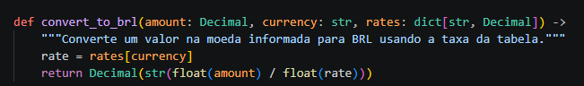
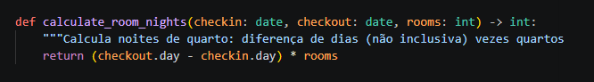
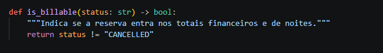
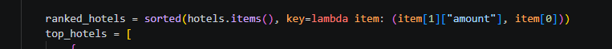
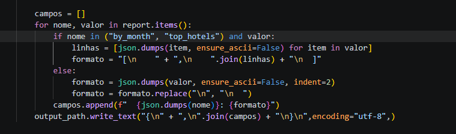

A primeira coisa que fiz foi rodar `pytest -q`. Pelos resultados dos testes, vi onde o programa retornava valores diferentes do esperado e fui olhar esses trechos do código.
Os dois primeiros erros estavam no `currency_converter.py`.

1. O código dividia `amount` pela taxa. No README, a regra era multiplicar `amount * rate`, então troquei a divisão pela multiplicação.
    
2. O código convertia `amount` e `rate` para `float` antes de calcular, o que podia causar perda de precisão. Mantive os dois valores como `Decimal`.
O terceiro erro estava na função `calculate_room_nights`.

3. O código subtraía só o número do dia de cada data. Por exemplo, de 30/01 a 02/02 ele fazia `2 - 30`, mas a estadia tinha 3 noites. Corrigi subtraindo a data de entrada da data de saída e multiplicando a diferença em dias pela quantidade de quartos.

O quarto erro estava no filtro de reservas, no `status_policy.py`.

4. O código excluía só as reservas com status `CANCELLED`, então as reservas `NO_SHOW` também entravam nos totais de gastos e diárias. Ajustei o filtro para incluir só as reservas com status `CONFIRMED` nesses cálculos.
O último erro estava no ranking de hotéis, no `report_builder.py`.

5. O código ordenava os gastos do menor para o maior. Corrigi a ordenação para mostrar os hotéis com maior gasto primeiro e, em caso de empate, mantive o menor ID na frente.

Por último, ajustei a gravação do JSON no `cli.py` para seguir o exemplo do README. Em `by_month` e `top_hotels`, deixei cada mês e cada hotel em uma única linha. Mantive os outros campos indentados e os valores do relatório continuaram os mesmos.

comando usado para gerar o report foi (python -m onfly_report --input data/reservas_hoteis.csv --rates data/taxas_cambio.csv --output output/report.json --top 5)
